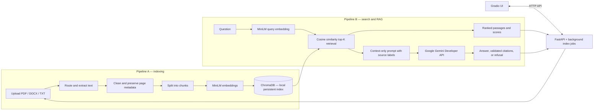

<p align="center">
  
</p>

<p align="center">Find answers in your documents, with sources you can check.</p>

## 1. Project Overview

Quillseek is a local-first document ingestion and semantic search application built for the seKer AI internship. It indexes PDF, DOCX, and TXT files on your computer, finds passages by meaning, and can ask Google Gemini to produce a concise answer with source citations.

The document index and uploaded files stay on the machine running Quillseek. For an Ask request, retrieved passages and the question are sent to the configured Gemini API. Do not index confidential documents unless that sharing is acceptable.

## 2. Business Problem

Keyword search misses information when a question and a document use different words for the same idea. For example, a question about “annual leave” may need to find a passage that says “paid vacation days.” Semantic retrieval compares meaning through text embeddings and returns ranked passages with document and page metadata.

## 3. Features

- Ingest PDF, DOCX, and TXT documents with per-file error handling.
- Clean extracted text, preserve page/section metadata, and split it into configurable chunks.
- Embed chunks with `sentence-transformers/all-MiniLM-L6-v2` and store them in a persistent local ChromaDB collection.
- Search by natural-language query, with ranked passages, similarity scores, and document/page details.
- Ask Gemini for a grounded answer with validated source labels; refuse when retrieval has no relevant evidence.
- Use the Gradio interface to upload, index, search, ask, delete documents, and reset the collection.
- Evaluate retrieval from a reviewed 29-question set and inspect per-question outputs in `eval/results/results.csv`.

## 4. Architecture

The Gradio frontend calls the FastAPI backend over HTTP. The backend owns ingestion, embedding, ChromaDB access, retrieval, and Gemini requests.



More detail is in [docs/architecture.md](docs/architecture.md) and the API guide is in [docs/api.md](docs/api.md).

## 5. Technology Stack

| Area | Choice | Why this choice / comparison |
|---|---|---|
| API | FastAPI + Uvicorn | Typed request/response models, validation, OpenAPI docs, and background indexing; keeps the service independently testable. |
| Interface | Gradio | Python-native UI suitable for a document-search demo; it calls the backend over HTTP instead of reaching into backend internals. |
| Vector store | ChromaDB, persistent local mode | Stores vectors with document/page metadata and persists between runs. FAISS is a strong vector-search library, but persistence and metadata filtering would need additional application-managed pieces. |
| Embeddings | `sentence-transformers/all-MiniLM-L6-v2` | A compact 384-dimensional model that can run locally on CPU. Larger embedding models may improve some tasks but use more memory and compute; no alternative model benchmark is claimed here. |
| Answer generation | Gemini Developer API via REST/HTTPX | Hosted generation avoids requiring a local GPU/LLM installation. Ollama or another local model would keep inference on-device but requires installing and running a model and may be slower on modest hardware. |
| Parsing | PyMuPDF and python-docx | Extract PDF pages and DOCX paragraphs/tables while retaining useful source metadata. |
| Chunking | Recursive text splitter plus sentence- and section-aware alternatives | The recorded experiment selected recursive chunks at 1,500 characters with zero overlap; see [docs/CHUNKING_EXPERIMENTS.md](docs/CHUNKING_EXPERIMENTS.md). |
| Configuration and tests | Pydantic Settings, `.env`, pytest | Typed settings with environment overrides, and unit/integration test coverage around the pipeline and API. |

### Repository layout

```text
backend/
  src/quillseek/       FastAPI app, settings, ingestion, chunking, embeddings,
                       ChromaDB, retrieval, and Gemini RAG services
  scripts/             Backend, indexing, corpus, search, and provider utilities
frontend/
  src/quillseek_frontend/  Gradio UI, API client, formatting, theme, and CSS
  scripts/                 Frontend launcher
  assets/                  Logos and favicon
tests/
  unit/                Isolated behavior and contract tests
  integration/         API, frontend/API, documentation, and live-provider tests
data/                  Sample corpus and local runtime data (runtime data is ignored)
eval/                  Reviewed questions, evaluation runners, and result artifacts
docs/                  Architecture, API, evaluation, chunking, and UI guides
scripts/               Repository-level security check
```

`backend/src` and `frontend/src` are added to the Python import path by the launchers and test configuration. Shared project material such as `README.md`, `requirements.txt`, `.gitignore`, `PLAN.md`, `GROUND_TRUTH.md`, and `.env.example` stays at the repository root. `.env`, local indexes, uploaded files, caches, and history files are excluded from Git.

### Backend details

The backend is a synchronous FastAPI application served by Uvicorn. Its API is the boundary between the user interface and application services; the frontend does not import backend service code. The main endpoints are:

| Endpoint | Purpose |
|---|---|
| `GET /health` | Reports API health, Gemini configuration/reachability, selected models, and indexed chunk count. |
| `POST /documents/upload` | Validates and stores PDF, DOCX, or TXT files in the local upload directory. |
| `GET /documents` | Lists indexed documents and files waiting to be indexed. |
| `POST /index` | Starts one background indexing job and returns its job ID. |
| `GET /index/status/{job_id}` | Returns indexing stage, progress, counts, and per-file failures. |
| `POST /search` | Embeds a query and returns relevant passages with scores and source metadata. |
| `POST /ask` | Retrieves context, asks Gemini for a grounded answer, and validates citations. |
| `DELETE /documents/{doc_id}` | Removes a document and its stored upload. |
| `DELETE /collection` | Clears the local vector collection and pending uploads. |

The indexing path validates file type and size, extracts text per page or section, cleans boilerplate, splits text, embeds each chunk, and stores the vectors plus metadata. Indexing runs in a single-worker background executor so the API can report progress while a job is active. Duplicate document IDs and individual file failures are handled by the indexing pipeline without requiring the whole batch to be discarded.

For search and Ask, the same configured embedding model encodes the query. ChromaDB returns top-K candidates, and the search service applies the configured relevance threshold. Ask passes a bounded set of retrieved excerpts to the LLM with labels such as `[S1]`; the RAG service validates that generated citations refer to supplied evidence. If retrieval is not relevant, it returns a fixed refusal without calling Gemini. Invalid citation output is returned as a safe API error.

### Frontend details

The frontend is a Python Gradio app, not a JavaScript SPA. It uses a small `APIClient` built on HTTPX to call the FastAPI service. `frontend/src/quillseek_frontend/app.py` builds the screen and wires UI events to that client; `api_client.py` owns HTTP requests and translates network/API errors; `formatting.py` safely escapes document text and renders answers, source excerpts, and passage results; `config.py` reads frontend settings; and `styles.css` plus `theme.py` provide the Quillseek presentation.

The first screen demonstrates the user journey: add/upload supported files, index them, then ask a question and inspect cited sources. A separate passage-search view returns raw matching chunks. Document management also exposes the indexed library, delete action, and guarded collection reset. The health indicator reports whether the backend is reachable and whether Gemini is configured. For a successful Ask request, the question and retrieved excerpts are sent to Gemini; uploads and the persistent ChromaDB index remain local to the machine running the backend.

### Test design and execution

The suite uses pytest and is organized by test scope. Tests use temporary directories, injected fake services, HTTPX mock transports, and FastAPI's in-process test client where possible. Most checks therefore do not call Gemini or require a running web server.

- **Unit tests (`tests/unit/`)** check small pieces in isolation: settings and defaults, file parsing and cleaning, chunking, embedding/store behavior, prompt construction, citation validation, Gemini request construction/error mapping, formatting, and UI structure/theme details. Provider and API calls are replaced by deterministic fakes or mock HTTP responses.
- **Integration tests (`tests/integration/`)** check that components work together: API routes with injected stores/services, upload-to-index flows, frontend API-client interactions, repository/security/documentation contracts, evaluation output, and UI configuration. These normally run locally without making live Gemini requests.
- **Live Gemini tests** are explicitly marked `gemini`. They make real network requests using the key loaded from `.env`, so they require internet access, a valid model/key, and remaining API quota. Provider quota or outage cases are reported as skips where appropriate; a skipped live test is not evidence of successful generation.
- **Regression suite** runs all collected tests. It should be run after focused tests when changing implementation. The local embedding model may need to be downloaded once; after it is cached, the non-live suite can run with Hugging Face offline mode enabled.

Run unit tests only:

```powershell
.\.venv\Scripts\python.exe -m pytest tests\unit -q
```

Run integration tests excluding live Gemini checks:

```powershell
$env:HF_HUB_OFFLINE='1'
.\.venv\Scripts\python.exe -m pytest tests\integration -m "not gemini" -q
```

Run the complete non-live regression suite:

```powershell
$env:HF_HUB_OFFLINE='1'
.\.venv\Scripts\python.exe -m pytest -m "not gemini" -q
```

Run live Gemini checks only when you intend to consume API quota:

```powershell
Remove-Item Env:GEMINI_API_KEY -ErrorAction SilentlyContinue
.\.venv\Scripts\python.exe -m pytest -m gemini -q
```

The API regression tests use fake LLMs and do not need the key. The environment-variable removal above makes the project `.env` the source for the live test key rather than a stale shell override. Never print or commit the secret.

### Local development workflow

Use two PowerShell terminals from the repository root. In terminal one, start the backend:

```powershell
.\.venv\Scripts\python.exe backend\scripts\run_backend.py
```

In terminal two, start the frontend:

```powershell
.\.venv\Scripts\python.exe frontend\scripts\run_frontend.py
```

Open `http://127.0.0.1:7860`. Upload a supported file, click the upload button, then index it. Wait for the indexing job to finish before asking a question. The backend logs show `/ask` status codes; a Gemini 429 means provider quota/rate limit, and a 502 can indicate invalid model citations. The message displayed in the UI gives the API's safe error detail.

To build and index the bundled sample corpus, use `backend\scripts\index_corpus.py`. To query retrieval from the terminal, use `backend\scripts\search_cli.py "your search query"`. To check a minimal Gemini REST request independently of document retrieval, run `backend\scripts\check_gemini.py`. API schema and interactive endpoints are available at `http://127.0.0.1:8000/docs` while the backend is running.

The project was developed on Windows with 16 GB RAM and Intel UHD 620 integrated graphics; the embedding model runs on CPU when a supported GPU is unavailable.

## 6. Installation

Clone the repository and create a Python 3.11+ environment (Python 3.10+ is the code target; the project was verified with Python 3.11):

```powershell
git clone https://github.com/mzainnasir010/docintel-semantic-search.git
cd docintel-semantic-search
python -m venv .venv
.\.venv\Scripts\Activate.ps1
python -m pip install --upgrade pip
python -m pip install -r requirements.txt
Copy-Item .env.example .env
```

Create or view a Gemini API key in [Google AI Studio](https://aistudio.google.com/apikey), then replace the placeholder for `GEMINI_API_KEY` in the project-root `.env`. The key must stay in `.env` or a private environment variable; never commit it or paste it into source files. Google’s [API key guide](https://ai.google.dev/gemini-api/docs/api-key) explains project/key setup. A configured key can still be subject to project quota limits.

The first embedding run may need internet access to download the configured sentence-transformers model. The model is cached for subsequent runs.

## 7. Configuration

Copy `.env.example` to `.env`. It contains variable names and a safe API-key placeholder; non-secret values are blank. Blank settings use the defaults below. Settings can also be provided through the process environment, which takes precedence over `.env`.

| Variable | Default | Purpose |
|---|---|---|
| `GEMINI_BASE_URL` | `https://generativelanguage.googleapis.com/v1beta` | Gemini REST API base URL. |
| `GEMINI_API_KEY` | unset | Secret used to authenticate Gemini requests. |
| `GEMINI_MODEL` | `gemini-3.8-flash` | Generation model name. |
| `EMBEDDING_MODEL` | `sentence-transformers/all-MiniLM-L6-v2` | Same embedding model is used for indexed chunks and queries. Changing it requires rebuilding the index. |
| `EMBEDDING_BATCH_SIZE` | `32` | Number of texts encoded in one embedding batch. |
| `CHROMA_PATH` | `data/chroma` | Local persistent vector database directory. |
| `COLLECTION_NAME` | `documents` | ChromaDB collection name. |
| `UPLOAD_DIR` | `data/uploads` | Local directory for uploaded files. |
| `MAX_UPLOAD_BYTES` | `20971520` (20 MiB) | Maximum accepted upload size per file. |
| `GRADIO_ORIGIN` | `http://127.0.0.1:7860` | Allowed browser origin for the API. |
| `CHUNK_SIZE` | `1500` | Target recursive chunk size in characters. |
| `CHUNK_OVERLAP` | `0` | Character overlap between adjacent chunks. |
| `CHUNK_STRATEGY` | `recursive` | Chunking strategy (`recursive`, `sentence`, or `section`). |
| `TOP_K` | `5` | Default number of search results/sources. |
| `MIN_SIMILARITY` | `0.25` | Similarity threshold below which a result is not considered relevant. |
| `LLM_TEMPERATURE` | `0.1` | Gemini generation temperature. |
| `LLM_MAX_OUTPUT_TOKENS` | `64` | Maximum generated output-token setting. |
| `LLM_THINKING_LEVEL` | `low` | Gemini thinking level used by requests. |
| `RAG_PROMPT_CHAR_BUDGET` | `1500` | Total character limit for the grounded prompt. |
| `API_HOST` | `127.0.0.1` | Host used by backend and frontend launchers. |
| `API_PORT` | `8000` | FastAPI/Uvicorn listening port. |
| `BACKEND_URL` | `http://127.0.0.1:8000` | Base URL the frontend uses for API calls. |
| `UI_PORT` | `7860` | Gradio listening port. |
| `LOG_LEVEL` | `INFO` | Console/file logging level. |

Runtime data directories (`data/chroma/` and `data/uploads/`) and `.env` are ignored by Git.
To change `EMBEDDING_MODEL`, follow the [full re-index procedure](docs/REINDEXING.md) so the persisted vectors match the new model.

## 8. Usage

Open two PowerShell terminals in the project directory. Start the backend in terminal 1:

```powershell
.\.venv\Scripts\python.exe backend\scripts\run_backend.py
```

Start the frontend in terminal 2:

```powershell
.\.venv\Scripts\python.exe frontend\scripts\run_frontend.py
```

Open `http://127.0.0.1:7860`. In **Documents**, upload supported files and select **Index pending documents**. Search the indexed library in **Search**, or ask a natural-language question in **Ask** and inspect its cited sources. The REST API is at `http://127.0.0.1:8000`; interactive API docs are at [`/docs`](http://127.0.0.1:8000/docs).

To index the bundled corpus from a terminal, run `.\.venv\Scripts\python.exe backend\scripts\index_corpus.py`. To test a search directly, run `.\.venv\Scripts\python.exe backend\scripts\search_cli.py "How do pure paths differ from concrete paths?"`.

Run the non-live suite (uses the cached embedding model):

```powershell
$env:HF_HUB_OFFLINE='1'
Remove-Item Env:GEMINI_API_KEY -ErrorAction SilentlyContinue
.\.venv\Scripts\python.exe -m pytest -m "not gemini"
```

Live Gemini tests are marked `gemini` and need a working `.env` key, internet access, and available project quota. To run them, clear any stale process override and use `.\.venv\Scripts\python.exe -m pytest -m gemini`. To check a minimal real request, use `.\.venv\Scripts\python.exe backend\scripts\check_gemini.py`.

For retrieval-only metrics without Gemini, run `.\.venv\Scripts\python.exe eval\run_eval.py --skip-rag`. When quota is available, resume answer-level evaluation with `.\.venv\Scripts\python.exe eval\run_eval.py --resume`.

## 9. Example Queries

These examples are measured against the current local index. “Correct” means the top result matches the expected document and page; it does not certify exact answer-bearing chunk relevance. See [docs/SEARCH_EXAMPLES.md](docs/SEARCH_EXAMPLES.md) and [docs/EVALUATION.md](docs/EVALUATION.md) for the measurement limitations.

| Query | Retrieved source | Similarity | Page-level result |
|---|---|---:|---|
| What kind of application code is asyncio described as a good fit for? | `python_asyncio.txt` | 0.619 | Correct |
| Why should an application limit the size of untrusted JSON input? | `python_json.docx` | 0.479 | Correct |
| How do pure paths differ from concrete paths? | `python_pathlib.docx` | 0.472 | Correct |
| What kinds of command-line arguments can `ArgumentParser.add_argument()` describe? | `python_argparse.pdf` | 0.717 | Partial; page 2 is not in top five |
| How do I configure Kubernetes horizontal pod autoscaling for production? | No relevant result | — | Weak match |

## 10. Evaluation

The current retrieval run covers 25 answerable and 4 unanswerable reviewed questions. Relevance is document/page-level, so it can overcount off-topic chunks from single-page text documents.

| K | Hit@K | Precision@K | Recall@K | MRR |
|---:|---:|---:|---:|---:|
| 3 | 0.880 | 0.613 | 0.860 | 0.880 |
| 5 | 0.920 | 0.600 | 0.900 | 0.890 |
| 10 | 0.960 | 0.544 | 0.960 | 0.894 |
| 20 | 1.000 | 0.416 | 1.000 | 0.896 |

K=5 remains the product default: larger candidate sets recovered two lower-ranked gold pages but reduced precision, and full-dataset generated answer quality remains unmeasured. Chunking experiments selected recursive 1,500-character chunks with zero overlap: MRR 0.890 and Hit@5 0.920 in that experiment. Full per-question findings and targeted live checks are in [docs/EVALUATION.md](docs/EVALUATION.md); the chunk sweep is in [docs/CHUNKING_EXPERIMENTS.md](docs/CHUNKING_EXPERIMENTS.md).

**Full-corpus Gemini answer, refusal, citation, token, and API-cost metrics remain pending.** Targeted live tests verified representative grounded answers and refusals, but the 29-question CSV remains retrieval-only; its answer-level fields are labeled as deferred because the provider quota was exhausted before a full run.

## 11. Screenshots

Browser automation was unavailable during implementation, so no screenshots are claimed here yet. The exact visual and capture checklist is in [docs/UI_MANUAL_CHECKLIST.md](docs/UI_MANUAL_CHECKLIST.md); requested PNGs belong in `docs/screenshots/`.

## 12. Limitations

- The sample corpus covers Python documentation, not arbitrary enterprise policies or private company material.
- PDF extraction quality depends on machine-readable text; scanned image-only documents need OCR, which is not implemented.
- Page-level evaluation labels are coarse and can count irrelevant chunks from the same document/page as relevant.
- Gemini generation quality, refusal behavior, citation grounding, token usage, and live answer costs have not been measured across the full 29-question evaluation; the API requires internet access and is subject to project-specific rate limits.
- The Gemini service requires internet access and is subject to project-specific rate limits. Retrieved passage text is sent to the configured provider for Ask requests.
- The UI was not browser-automated; complete the manual responsive/console checks and capture screenshots before delivery.

## 13. Future Improvements

- Re-run the full live RAG evaluation and inspect generated citations and refusals when Gemini quota permits.
- Add chunk-level gold evidence spans to reduce page-label scoring ambiguity.
- Explore query-aware retrieval or reranking only after measured before/after tests.
- Add OCR for scanned PDFs and broader, user-approved domain corpora.
- Capture the desktop and narrow-width UI states listed in the manual checklist.
