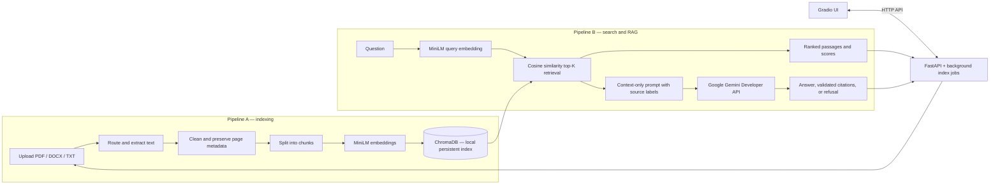

# Quillseek architecture

Quillseek separates its Gradio interface from the FastAPI backend. The browser sends JSON and multipart requests to the backend; the backend runs document processing, local vector retrieval, and optional hosted Gemini generation.

## Indexing path

The upload endpoint validates and stores supported files. The indexing job routes each file to its PDF, DOCX, or TXT loader, preprocesses and chunks extracted text, embeds chunks with the configured sentence-transformers model, and upserts vectors plus document/page metadata into a persistent local ChromaDB collection. Job status is available through the API while indexing runs.

## Query and answer path

The backend embeds a query with the same model used for documents, retrieves cosine-ranked chunks from ChromaDB, applies the configured minimum similarity, and returns ranked passages for search. Ask builds a bounded context-only prompt with source labels and sends it to Gemini through HTTPX. The RAG service validates that citations refer to provided source labels and returns an explicit refusal when the retrieved evidence is insufficient.

## Runtime boundaries

- The Gradio process uses `quillseek_frontend.APIClient`; it does not open ChromaDB or call Gemini directly.
- The FastAPI process owns upload/index/search/ask routes and the indexing job manager.
- Uploaded files and the vector index are local runtime data and are ignored by Git.
- Ask requests send the question and retrieved passage context to the Gemini Developer API; API keys remain in server-side configuration.
